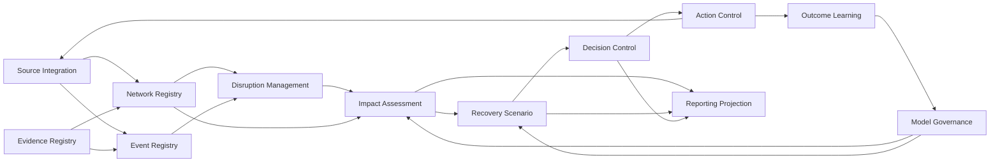
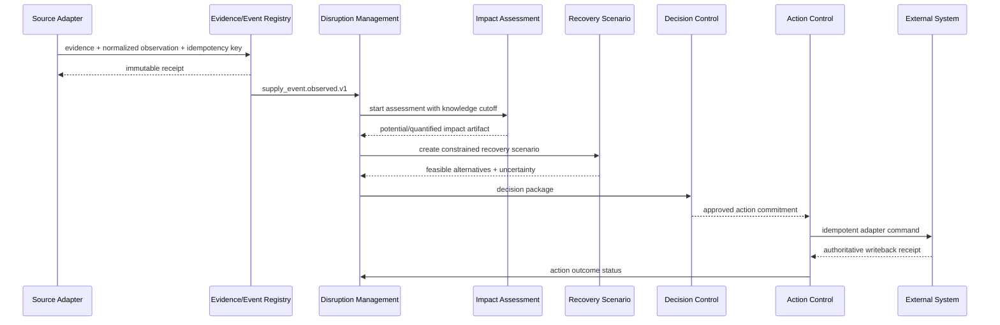

# Architecture — Supply Chain Control Plane

## 1. Architectural intent

Supply Chain Control Plane is a federated decision system. It does not centralize every supply-chain transaction. It builds a time-safe, evidence-linked decision context across authoritative operating systems and owns the resulting cases, assessments, scenarios, decisions, actions, and outcomes.

The architecture follows Domain-Driven Design, minimal aggregate transaction boundaries, explicit anti-corruption layers, and versioned released integration contracts.

## 2. Strategic domain model

### Core subdomains

1. **Supply Network Twin** — resolves cross-system supply identities and evidence-backed dependency, flow, substitution, and capacity relations.
2. **Supply Event Intelligence** — records normalized observations, corrections, source authority, availability, and provenance.
3. **Disruption Management** — maintains cases, hypotheses, affected subjects, evidence gaps, ownership, and status transitions.
4. **Impact Assessment** — computes deterministic exposure and validated quantitative consequences.
5. **Recovery Scenario** — represents constraints, candidate actions, simulation or optimization runs, and trade-offs.
6. **Decision and Action Control** — records options, approvals, commitments, writeback, execution, and outcomes.
7. **Outcome Learning** — evaluates predicted versus realized results and proposes reviewed model or policy changes.

### Supporting subdomains

- Source Integration
- Traceability and Standards Mapping
- Evidence and Chain of Custody
- Partner Collaboration
- Model Governance
- Search and Reporting Projection

### Generic subdomains

- Identity and Access
- Audit and Retention
- Notifications
- Document Authoring
- Telemetry
- Deployment and Release

## 3. Bounded contexts

### Network Registry

Publishes stable supply-object references and admitted relations. It retains the source authority and validity of each mapping but does not replace the source master.

### Evidence Registry

Publishes immutable evidence references, digests, classification, and authorized retrieval. It does not interpret business meaning or execute content.

### Event Registry

Publishes normalized event records with event, availability, and system times. It owns correction lineage and source receipts, not the external transaction.

### Disruption Management

Owns the disruption case lifecycle. It can reference observations and hypotheses but cannot promote an inference to an authoritative source fact.

### Impact Assessment

Consumes immutable network and event snapshots. It publishes potential exposure and registered quantitative results. A completed assessment is immutable; a correction creates a new run.

### Recovery Scenario

Owns proposed actions and constraints. It can consume impact results but cannot write to operating systems.

### Decision Control

Owns the human decision, approval, expiry, residual risk, and selected option. It is the only bounded context that can authorize Action Control.

### Action Control

Owns action commitments, adapter commands, idempotency, receipts, partial failure, reconciliation, and outcome requests. It does not own the resulting ERP, WMS, TMS, MES, or QMS state.

### Outcome Learning

Owns predicted-versus-realized evaluation. It can propose a model or policy revision but cannot change active behavior without Model Governance approval.

## 4. Context relationships

| Upstream | Downstream | Relationship | Rule |
| --- | --- | --- | --- |
| ERP/MDM/PLM/MES/WMS/TMS/QMS | Source Integration | Anti-corruption layer | Vendor vocabulary remains outside the domain core |
| Evidence Registry | Network/Event Registry | Published language | Stable evidence references only |
| Network Registry | Impact Assessment | Customer/supplier | Immutable snapshot reference |
| Event Registry | Disruption Management | Customer/supplier | Truth status and temporal semantics preserved |
| Impact Assessment | Recovery Scenario | Published language | Assessment results are immutable inputs |
| Recovery Scenario | Decision Control | Open host service | Scenario cannot self-approve |
| Decision Control | Action Control | Conformist | Only approved and unexpired decisions authorize writeback |
| Action Control | External operating system | ACL | Commands are versioned, idempotent, and reconciled |
| Outcome Learning | Model Governance | Proposed mapping | Evaluation can propose but not activate changes |
| Reporting Projection | User interfaces | CQRS read model | Projection has no write authority |

## 5. Authority map

| Fact | Authority |
| --- | --- |
| Legal party and trading partner master | Customer ERP or MDM |
| Item, BOM, specification, and routing | ERP, PLM, or MES |
| Purchase and sales order | ERP |
| Inventory adjustment and warehouse task | WMS or ERP |
| Production execution and equipment state | MES or plant system |
| Quality inspection and disposition | QMS |
| Shipment execution and proof of delivery | TMS or carrier |
| Cross-system supply identity and relation | Supply Chain Control Plane |
| Normalized observation and provenance | Supply Chain Control Plane |
| Disruption case and hypothesis | Supply Chain Control Plane |
| Impact assessment and scenario artifact | Supply Chain Control Plane |
| Decision, approval, action, and outcome review | Supply Chain Control Plane |
| User and service credential | `keyverse` or a verified customer IdP |
| Internal people, organization, position, assignment, and responsibility | `Orgmetra` where adopted |
| Formal enterprise risk acceptance and control evidence | `governance-risk-compliance` |
| Application, capability, technology, initiative, and transformation truth | `enterprise-architecture-core` |
| Ontology publication and semantic release | `ConceptWeave` |
| Data catalog, glossary, data product, lineage, and governed consumption | `semantic-data-portal` |
| CWL product usage, pricing, contract, and commercial entitlement | `metering-billing-platform` |
| Accounting journal, ledger, posting, and financial-control truth | Customer accounting authority or `accounting-information-platform` where adopted |

## 6. Aggregate design

The current `SupplyGraph` is an in-memory foundation aggregate used to prove deterministic graph behavior. Durable design separates the following aggregate boundaries:

- `SupplyNodeAggregate`
- `SupplyDependencyAggregate`
- `EvidenceRecordAggregate`
- `SupplyEventAggregate`
- `DisruptionCaseAggregate`
- `ImpactAssessmentRunAggregate`
- `RecoveryScenarioAggregate`
- `DecisionRecordAggregate`
- `ActionCommitmentAggregate`
- `ModelReleaseAggregate`

No aggregate transaction spans an external system. Cross-context coordination uses application services, outbox events, sagas, and reconciliation receipts.

## 7. Key invariants

- A supply node, dependency, event, evidence record, model release, and writeback command has a stable semantic identity.
- Exact replay is idempotent; changed immutable content is a conflict.
- Every admitted network relation and observation has evidence and source authority.
- Every claim has truth status and temporal validity.
- Inferred and proposed claims cannot automatically become authoritative.
- Historical analysis excludes evidence unavailable at the knowledge cutoff.
- Every assessment references an immutable input snapshot and implementation version.
- Every scenario distinguishes hard constraints from preferences.
- Every decision has a human or explicitly authorized non-human approver distinct from an untrusted proposer.
- Every state-changing external command is idempotent and reconciled.
- A failed or partial action remains visible; it cannot be reported as complete through a notification alone.
- Outcome information does not rewrite the original decision basis.
- Cross-tenant references and reads are rejected at application and database boundaries.

## 8. Deployment evolution

### Stage A — Domain library

Current state: dependency-free Rust graph and evidence behavior with tests.

### Stage B — Modular application

A single deployable Rust service contains bounded modules, PostgreSQL, object storage, and durable events. This is the preferred first networked product because it minimizes distributed failure while preserving boundaries.

### Stage C — Independently scalable workers

Impact, simulation, optimization, import, and export workers separate when measured resource and lifecycle evidence requires it. Commands and artifacts remain on versioned contracts.

### Stage D — Selective service extraction

A bounded context becomes a separate service only when at least one condition is demonstrated:

- independent team or release ownership;
- distinct trust or data-residency boundary;
- materially different scaling or resource profile;
- separate availability objective;
- repeated external reuse with a stable contract.

## 9. Data and event flow

## 10. Architectural decisions

- ADR 0001: Evidence-first disruption impact
- ADR 0002: Control plane, not ERP replacement
- ADR 0003: Bitemporal evidence and truth status
- ADR 0004: Versioned API and event contracts
- ADR 0005: Rust quantitative decision core
- ADR 0006: Federated CWL integration

All new architecture decisions remain `Proposed` until their prerequisite implementation and evidence are merged. The existing implemented decision in ADR 0001 retains the status recorded in that ADR.
