# Context Map — Supply Chain Control Plane and CWL Ecosystem

## 1. Integration rule

Supply Chain Control Plane owns supply-network identity, admitted observations, disruption cases, impact assessments, recovery scenarios, decisions, action commitments, and outcome learning. It consumes only released, versioned owner contracts for capabilities that belong elsewhere. It does not copy source code, schemas, prompts, model kernels, or database truth from another repository, and production never depends on mutable sibling heads, branch URLs, or cross-repository filesystem paths.

When a reusable owner capability is incomplete, the owner repository receives the failing contract test, implementation, documentation, and release work. This repository integrates the released result after provider and consumer CI are green. A temporary bridge must name the owner issue, expiry, deletion condition, and production prohibition.

## 2. Ecosystem map

```mermaid
flowchart TB
    CGC[context-graph-contracts] --> SC[Supply Chain Control Plane]
    KV[keyverse] --> SC
    ORG[Orgmetra] --> SC
    EA[enterprise-architecture-core] <--> SC
    CW[ConceptWeave] --> SDP[semantic-data-portal]
    SDP <--> SC

    CO[contextual-orchestrator] --> SC
    BATCH[pg-llm-batch] --> CO
    TEPP[TEPP] --> SC
    FM[fast-mlsirm] --> SC
    ER[EmbedRelay] --> SC

    MHTML[mhtml-etl-gateway] --> SC
    ETL[mightyETL] --> SC
    NDOM[newsdom-api] --> SC
    OW[OriginWeave] --> SC
    TW[ThreadWeave] --> SC
    LW[LineageWeave] --> SC
    RW[RankWeave] --> SC
    INK[inkspan] --> SC
    DIAG[DiagramWeave] -. design and evidence tooling .-> SC
    NAR[naruon] <--> SC

    GRC[governance-risk-compliance] <--> SC
    QR[quarantine-sandbox-runtime] --> SC
    WN[wardnet] --> SC
    EW[EgressWeave] --> SC
    PG[pingora-gateway] --> SC
    AG[appguardrail] -. development evidence .-> SC

    MBP[metering-billing-platform] <--> SC
    AIP[accounting-information-platform] <--> SC
    NE[noema] -. released workflow contract only .-> SC
```

The arrows describe intended versioned contract relationships, not current release readiness. Optional or immature owners are not synchronous production prerequisites until their published contracts, operational evidence, and consumer tests justify that coupling.

## 3. Foundation and authority owners

### `context-graph-contracts`

**Owner responsibility:** canonical cross-product identifiers, truth status, bitemporal relation, provenance reference, event envelope, and conformance fixtures.

**Consumed by this product:** canonical object references, truth-status vocabulary, temporal validity structures, provenance references, CloudEvents extensions, and compatibility fixtures.

**Boundary:** supply-chain concepts, relation meanings, invariants, decisions, and operational truth remain in this repository.

### `keyverse`

**Owner responsibility:** identity, OIDC, OAuth, passkeys, SCIM, federation, and credential lifecycle.

**Consumed by this product:** verified subject, tenant membership, service principal, group or role claim, token context, and delegated authority.

**Boundary:** a supply party is not a login identity. Credentials and passkeys are never copied into the supply-chain database, and an email address is not an identity-merge key.

### `Orgmetra`

**Owner responsibility:** people, employment, organization, job, position, assignment, and internal responsibility truth.

**Consumed by this product:** opaque organization-unit, position, assignment, and approval-role references where a customer elects to integrate internal workforce authority.

**Boundary:** supplier and customer party masters remain ERP or MDM truth; Supply Chain Control Plane does not copy employee records or infer approval authority from email metadata.

### `enterprise-architecture-core`

**Owner responsibility:** business capability, application, interface, technology, assessment, initiative, transformation, and target-state decisions.

**Consumed by this product:** application and technology dependencies relevant to source systems, adapters, operating facilities, and change impact.

**Published by this product:** released operational-dependency and decision evidence that may inform architecture assessment.

**Boundary:** enterprise architecture objects are referenced rather than duplicated as supply-domain truth. Any supply-domain projection retains EA authority, version, provenance, and validity.

### `ConceptWeave`

**Owner responsibility:** ontology observation, discovery, proposal, alignment, validation, review, publication, and semantic release.

**Consumed relationship:** supply-chain domain concepts and labels remain authored in this product, while reusable cross-domain ontology releases may be proposed to and published by `ConceptWeave`.

**Boundary:** unpublished or merely proposed concepts cannot become production interoperability contracts.

### `semantic-data-portal`

**Owner responsibility:** data and ontology catalog, glossary, data product, governance, lineage, quality context, and policy-filtered consumption.

**Consumed by this product:** released data asset references, glossary and ontology releases, data contracts, lineage, quality observations, and governance context.

**Published by this product:** supply-chain datasets, events, APIs, model artifacts, lineage, quality evidence, and released semantic labels.

**Boundary:** `semantic-data-portal` is not the supplier, item, order, event, disruption case, decision, or action record. It catalogs and governs projections without taking domain command authority.

## 4. Intelligence and quantitative owners

### `contextual-orchestrator`

**Owner responsibility:** model discovery, modality-aware selection, structured output, tool use, streaming, fallback, and LLM workflow execution.

**Consumed operations:** evidence extraction, source comparison, mapping proposals, draft explanations, translation, and unsupported-claim verification.

**Boundary:** numeric supply-chain decisions are never delegated to an LLM. Model output enters as `proposed` or `inferred`, carries evidence and execution provenance, and requires deterministic validation before use.

### `pg-llm-batch`

**Owner responsibility:** durable batch/token preparation and provider batch lifecycle under released contracts.

**Consumed relationship:** high-volume evidence extraction may use a released batch path that still routes model execution through `contextual-orchestrator` contracts.

**Boundary:** batch transport does not own prompts, provider selection, supply-domain decisions, or billing truth.

### `TEPP`

**Owner responsibility:** multilingual, temporal, event, relation, multilevel, and multiple-membership analytical artifacts.

**Consumed by this product:** released temporal and event analyses for external signals, supplier narratives, longitudinal change, and outcome evaluation.

**Boundary:** TEPP artifacts do not overwrite observed supply events, operational measures, or authoritative decisions.

### `fast-mlsirm`

**Owner responsibility:** reusable psychometric numerical kernels and validated latent-trait estimation.

**Consumed by this product:** optional supplier-assessment and evaluator-severity models with explicit construct, rater, DIF, criterion-validity, and recovery evidence.

**Boundary:** psychometric estimates do not replace OTIF, defect, lead-time, inventory, capacity, cost, or event evidence.

### `EmbedRelay`

**Owner responsibility:** versioned embedding-space identity, validated directed adapters, migration control, confidence gates, and native backfill.

**Consumed relationship:** evidence-search indexes may migrate through a released adapter without comparing raw vectors from different spaces.

**Boundary:** translated vectors remain approximations with provenance; they do not become supply facts, and native backfill remains the target state.

## 5. Ingestion, evidence, retrieval, and collaboration owners

### `mhtml-etl-gateway`

**Owner responsibility:** safe MHTML inspection, deterministic table extraction, schema proposal, governed load staging, and row lineage.

**Consumed by this product:** sanitized import artifacts and steward-reviewed schema proposals for legacy supply-chain exports.

**Boundary:** the gateway cannot create or mutate canonical control-plane tables without a versioned adapter command and domain validation.

### `mightyETL`

**Owner responsibility:** released CDC and bounded ETL capabilities.

**Consumed by this product:** source change streams only where the owner declares production support and publishes interoperability evidence.

**Boundary:** scaffolded connectors are not treated as supported, and database replication never bypasses domain admission.

### `newsdom-api`

**Owner responsibility:** released document-structure extraction contracts for supported document types.

**Consumed by this product:** page, section, table, image, caption, bounding-box, and source-span evidence where a released parser profile exists.

**Boundary:** parsed document structure remains untrusted input until source authenticity, malware, MIME, licensing, and domain invariants are verified.

### `OriginWeave`

**Owner responsibility:** safe browser observation, extraction, provenance, policy, and agentic web runtime.

**Consumed by this product:** supplier, port, regulator, recall, weather, logistics, and market observations with provenance.

**Boundary:** until a production release exists, external signals enter through reviewed APIs or manual evidence upload. Web content is data, never instruction.

### `ThreadWeave`

**Owner responsibility:** standards-based message threading.

**Consumed by this product:** supplier, carrier, customer, and internal communication thread structure.

**Boundary:** message content and decision truth remain in their source systems; thread membership is not an operational decision.

### `LineageWeave`

**Owner responsibility:** inferred branching lineage across fragmented records.

**Consumed by this product:** analyst-only proposed connections among events, messages, documents, cases, and decisions.

**Boundary:** every result enters as `inferred` or `proposed` and cannot be promoted automatically to observed or authoritative truth.

### `RankWeave`

**Owner responsibility:** deterministic retrieval fusion and retrieval evaluation.

**Consumed by this product:** evidence retrieval across exact, lexical, dense, graph, and temporal channels.

**Boundary:** retrieval rank is not supplier risk, scenario utility, or action priority without a separately validated decision policy.

### `inkspan`

**Owner responsibility:** collaborative authoring and deterministic document serialization.

**Consumed by this product:** disruption reviews, decision memoranda, supplier corrective actions, and post-action reviews.

**Boundary:** Supply Chain Control Plane owns workflow, permissions, records, and approval state; `inkspan` owns the reusable authoring surface.

### `DiagramWeave`

**Owner responsibility:** diagram patching, rendering, CLI/LSP behavior, and revision-bound diagram evidence.

**Consumed relationship:** architecture, process, scenario, and incident diagrams may be generated and rendered from versioned source.

**Boundary:** a diagram is a view of domain records and never the command authority or canonical graph.

### `naruon`

**Owner responsibility:** customer-owned mail, calendar, file, and interaction control-plane contracts.

**Consumed and published:** notification, meeting, evidence-request, acknowledgement, and partner-communication intent/result contracts.

**Boundary:** `naruon` is not the disruption, decision, action, order, shipment, or supply transaction record.

## 6. Security, runtime, and engineering owners

### `quarantine-sandbox-runtime`

**Owner responsibility:** hostile-workload isolation, resource limits, filesystem and syscall restrictions, ephemeral workspaces, artifact hashing, and cleanup/recovery.

**Consumed by this product:** isolated processing for hostile documents, connector payloads, and analysis profiles.

**Boundary:** this repository invokes released isolation profiles rather than copying a container or sandbox implementation.

### `wardnet`

**Owner responsibility:** gateway and security-operations controls under released contracts.

**Consumed by this product:** network security policy, detection, and operational security evidence where applicable.

**Boundary:** `wardnet` does not own supply decisions or product authorization.

### `EgressWeave`

**Owner responsibility:** outbound host, port, method, DNS, redirect, size, and timeout policy for supported runtimes.

**Consumed by this product:** released outbound-policy contracts for adapters that need controlled network access.

**Boundary:** adapters written in unsupported runtimes implement an equivalent reviewed policy or use a dedicated gateway; they do not bypass egress controls.

### `pingora-gateway`

**Owner responsibility:** edge-routing, connection, and gateway capabilities under its released contract.

**Consumed relationship:** an externally deployed control plane may use it as an edge adapter after authentication, authorization, tenancy, and failure semantics are proven end to end.

**Boundary:** edge routing does not become business authorization or tenant truth.

### `appguardrail`

**Owner responsibility:** SAST/SARIF and reusable security detection.

**Consumed relationship:** repository and release pipelines consume security findings as development evidence.

**Boundary:** SAST is not a runtime control, and scanner success does not replace threat-model, integration, or penetration evidence.

### `noema`

**Owner responsibility:** only the capabilities actually present in a released and documented owner contract.

**Consumed relationship:** workflow, task, short-lived authority, or exact-head evidence may be integrated only after provider/consumer contract tests establish the boundary.

**Boundary:** this product does not assume an aspirational Noema runtime API, copy its implementation, or make a mutable head a prerequisite.

### `ContextualWisdomLab/.github`

**Owner responsibility:** shared workflow, review, security, release, ruleset, and scheduler governance.

**Consumed relationship:** thin repository callers and organization-required workflows.

**Boundary:** product-specific domain tests and release evidence remain in this repository; central governance is not copied locally.

## 7. Commercial and accounting owners

### `metering-billing-platform`

**Owner responsibility:** CWL product usage, pricing, contract, entitlement, invoice intent, payment, settlement, and reconciliation truth.

**Consumed and published:** Supply Chain Control Plane emits canonical product usage and receives commercial entitlement decisions.

**Boundary:** supplier purchase orders, supplier invoices, accounts payable, and procurement payments remain customer ERP/accounting truth and are never modeled as CWL product billing records.

### `accounting-information-platform`

**Owner responsibility:** journal, ledger, period, posting, reconciliation, and financial-control truth for integrations that adopt the CWL accounting product.

**Consumed and published:** approved operational-cost or recovery-impact references may be projected through a released accounting contract; posting receipts may be referenced for reconciliation.

**Boundary:** Supply Chain Control Plane does not post directly to accounting tables, own the general ledger, or treat a scenario estimate as an accounting entry.

## 8. External context map

| External context | Relationship | Imported semantics |
| --- | --- | --- |
| ERP/MDM | Anti-corruption layer | Parties, items, orders, commercial references |
| PLM | Anti-corruption layer | Specifications, BOM, approved substitutions |
| MES | Anti-corruption layer | Production orders, operations, capacity and execution events |
| QMS | Anti-corruption layer | Inspection, nonconformance, disposition, corrective action references |
| WMS | Anti-corruption layer | Inventory positions, allocations, warehouse tasks |
| TMS/carrier | Anti-corruption layer | Shipment, milestone, route, proof-of-delivery events |
| SRM/supplier portal | Anti-corruption layer | Supplier commitments, responses, qualification references |
| EPCIS repository | Standards adapter | Visibility events and query/capture semantics |
| Market/risk data provider | Published API adapter | External observations with licensing and provenance |

## 9. Integrated CI contract

For every owner/consumer integration:

1. the owner publishes schemas, clients, artifacts, SBOM, provenance, compatibility policy, and release notes;
2. the consumer pins the version, digest, or exact immutable release SHA;
3. the owner verifies consumer fixtures against the exact release candidate;
4. the consumer verifies build, API/schema, fallback, streaming, timeout, security, and end-to-end behavior against that exact release;
5. mutable sibling branches, branch URLs, and cross-repository paths are rejected;
6. deprecation records supported versions, migration steps, end date, and removal criteria;
7. temporary bridges record owner issue, expiry, deletion condition, and production prohibition;
8. no owner or consumer claims release readiness until integrated CI is green on both sides.
