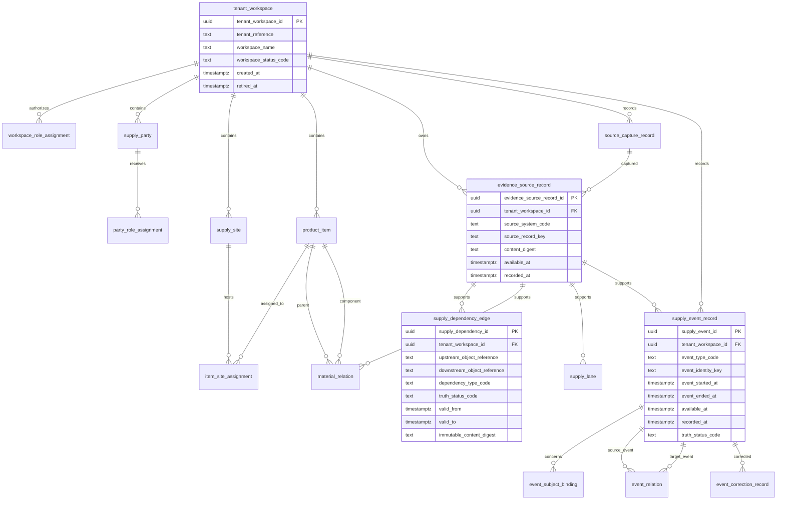
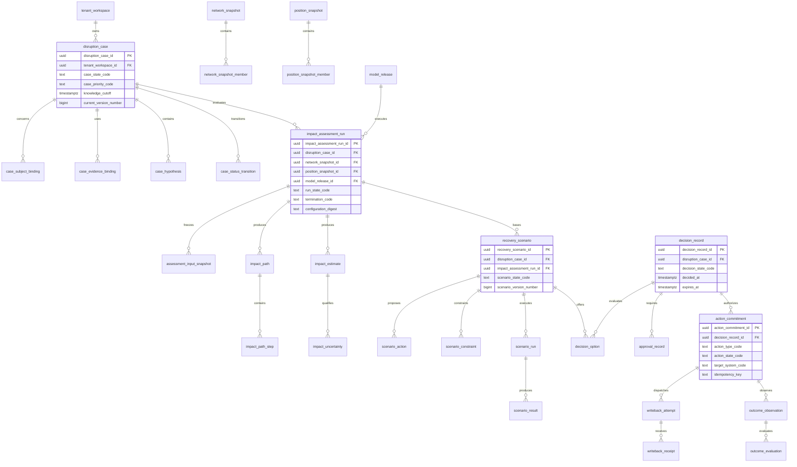
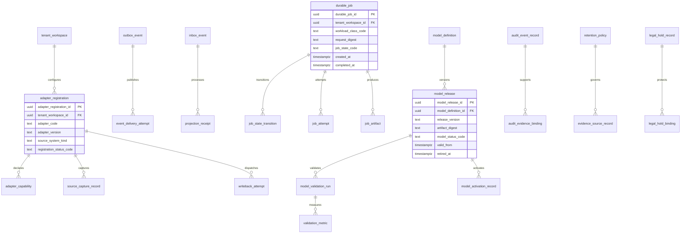

# Logical ERD — Supply Chain Control Plane

## 1. ERD authority

This document is the reviewable logical relationship view of `docs/DATA_MODEL.md`. The field lists, constraints, temporal semantics, and migration rules in `docs/DATA_MODEL.md` remain authoritative. Generated physical ERDs must be compared against migrations and may not silently redefine the model.

## 2. Workspace, evidence, network, and events

## 3. Cases, assessments, scenarios, decisions, and actions

## 4. Integration, jobs, projection, and governance

## 5. Physical-model rules

- Foreign keys include tenant consistency, not only object identity.
- Valid-time intervals cannot overlap where one active semantic fact is allowed.
- Immutable event/evidence/decision/action history is append-only.
- External IDs reside in external-reference or object-mapping tables.
- Decision-critical amounts, quantities, units, statuses, and authorization fields are relational columns rather than opaque JSONB.
- Event and audit partitions are introduced only with measured volume and query evidence; the logical identity remains stable.
- Read projections may denormalize but have no command authority.
- Each migration must reproduce this ERD from a clean database and from the supported N-1 schema.
