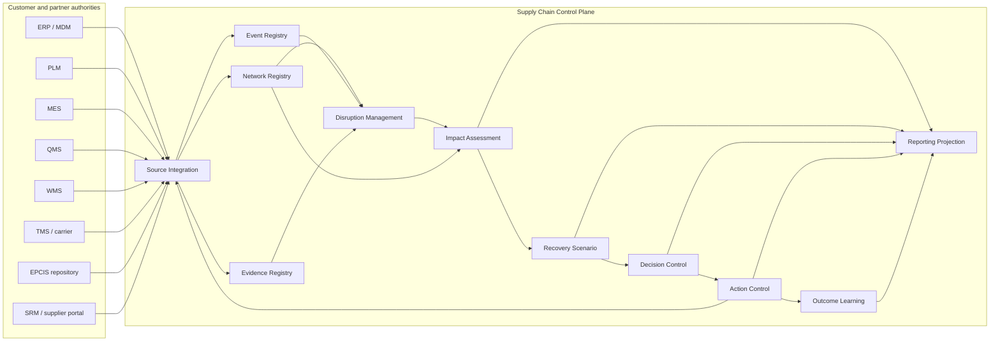
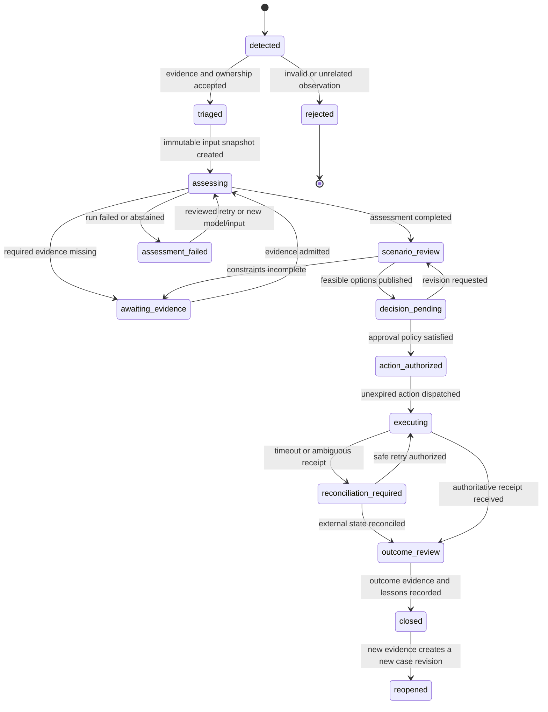
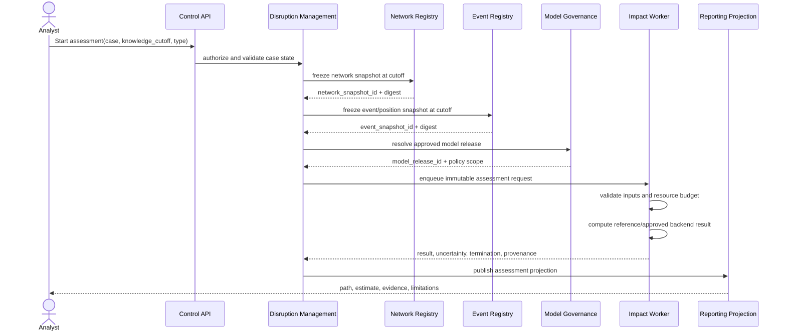
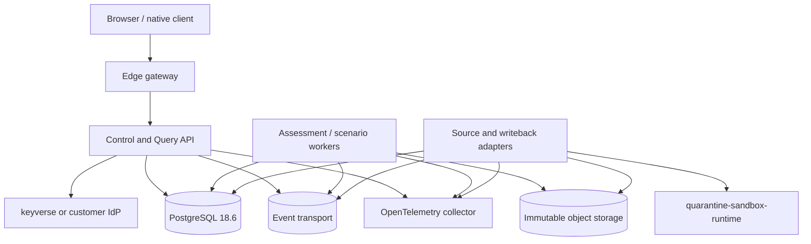

# UML Views — Supply Chain Control Plane

## 1. Diagram authority

These views make the product behavior reviewable. They do not replace the textual invariants in `ARCHITECTURE.md`, `docs/DOMAIN_MODEL.md`, `docs/DATA_MODEL.md`, `docs/API_CONTRACT.md`, or `docs/EVENT_CONTRACT.md`. A diagram change that alters ownership, state, public contract, or persistence semantics also changes those authorities and requires ADR review.

## 2. Component view



## 3. Domain class view

```mermaid
classDiagram
    class TenantWorkspace {
      +TenantWorkspaceId tenant_workspace_id
      +WorkspaceStatusCode workspace_status_code
    }
    class SupplyParty {
      +SupplyPartyId supply_party_id
      +PartyLifecycleCode lifecycle_code
    }
    class SupplySite {
      +SupplySiteId supply_site_id
      +SiteKindCode site_kind_code
    }
    class ProductItem {
      +ProductItemId product_item_id
      +ItemKindCode item_kind_code
    }
    class SupplyDependency {
      +SupplyDependencyId supply_dependency_id
      +DependencyTypeCode dependency_type_code
      +TruthStatusCode truth_status_code
      +ValidityInterval validity_interval
    }
    class EvidenceReference {
      +EvidenceSourceRecordId evidence_source_record_id
      +ContentDigest content_digest
      +AvailabilityTime available_at
    }
    class SupplyEvent {
      +SupplyEventId supply_event_id
      +EventTypeCode event_type_code
      +TimeInterval occurrence_interval
      +TruthStatusCode truth_status_code
    }
    class DisruptionCase {
      +DisruptionCaseId disruption_case_id
      +CaseStateCode case_state_code
      +KnowledgeCutoff knowledge_cutoff
    }
    class ImpactAssessmentRun {
      +ImpactAssessmentRunId impact_assessment_run_id
      +AssessmentTypeCode assessment_type_code
      +RunStateCode run_state_code
      +TerminationCode termination_code
    }
    class ImpactPath {
      +ImpactPathId impact_path_id
      +HopCount hop_count
    }
    class RecoveryScenario {
      +RecoveryScenarioId recovery_scenario_id
      +ScenarioStateCode scenario_state_code
    }
    class ScenarioConstraint {
      +ConstraintId constraint_id
      +ConstraintKindCode constraint_kind_code
      +ConstraintStrengthCode strength_code
    }
    class DecisionRecord {
      +DecisionRecordId decision_record_id
      +DecisionStateCode decision_state_code
      +DecisionExpiry expires_at
    }
    class ActionCommitment {
      +ActionCommitmentId action_commitment_id
      +ActionStateCode action_state_code
      +IdempotencyKey idempotency_key
    }
    class WritebackReceipt {
      +WritebackReceiptId writeback_receipt_id
      +ReceiptStateCode receipt_state_code
    }
    class OutcomeObservation {
      +OutcomeObservationId outcome_observation_id
      +ObservationTime observed_at
    }
    class ModelRelease {
      +ModelReleaseId model_release_id
      +ModelStatusCode model_status_code
      +ArtifactDigest artifact_digest
    }

    TenantWorkspace "1" --> "*" SupplyParty
    TenantWorkspace "1" --> "*" SupplySite
    TenantWorkspace "1" --> "*" ProductItem
    SupplyDependency "*" --> "1" EvidenceReference : supported_by
    SupplyEvent "*" --> "1" EvidenceReference : supported_by
    DisruptionCase "1" --> "*" SupplyEvent : considers
    DisruptionCase "1" --> "*" ImpactAssessmentRun
    ImpactAssessmentRun "1" --> "*" ImpactPath
    ImpactAssessmentRun "*" --> "1" ModelRelease : uses
    RecoveryScenario "*" --> "1" ImpactAssessmentRun : based_on
    RecoveryScenario "1" --> "*" ScenarioConstraint
    DecisionRecord "*" --> "1" RecoveryScenario : selects
    DecisionRecord "1" --> "*" ActionCommitment : authorizes
    ActionCommitment "1" --> "*" WritebackReceipt
    ActionCommitment "1" --> "*" OutcomeObservation
```



## 4. Disruption case state machine



No transition deletes prior state. Reopening preserves the original case, decision basis, and action receipts.

## 5. Assessment sequence



## 6. Decision and writeback sequence

```mermaid
sequenceDiagram
    actor Planner
    actor Approver
    participant API as Control API
    participant Scenario as Recovery Scenario
    participant Decision as Decision Control
    participant Action as Action Control
    participant Adapter as Operating-System Adapter
    participant Source as ERP/WMS/TMS/MES/QMS

    Planner->>API: Submit scenario for decision
    API->>Scenario: verify immutable result and expiry
    Scenario-->>Decision: decision basis reference
    Approver->>API: Approve explicit option and action scope
    API->>Decision: verify role, purpose, segregation, expiry
    Decision-->>Action: authorize commitments
    Action->>Adapter: dispatch(idempotency_key, expected version)
    Adapter->>Source: versioned state-changing command
    alt authoritative success receipt
      Source-->>Adapter: applied + external reference
      Adapter-->>Action: confirmed receipt
    else timeout or uncertain result
      Adapter-->>Action: ambiguous receipt
      Action->>Action: block blind retry; require reconciliation
    else explicit rejection
      Source-->>Adapter: rejected + reason
      Adapter-->>Action: failed receipt
    end
    Action-->>Planner: state and next permissible action
```

## 7. Evidence correction and historical replay

```mermaid
sequenceDiagram
    participant Adapter
    participant Evidence
    participant Event
    participant Assessment

    Adapter->>Evidence: admit source artifact and capture receipt
    Evidence-->>Adapter: immutable evidence reference
    Adapter->>Event: admit observed event with available_at
    Event-->>Adapter: event identity and digest
    Adapter->>Event: submit correction referencing prior event
    Event->>Event: close prior system-valid record; append corrected record
    Assessment->>Event: query available_at <= knowledge_cutoff
    Event-->>Assessment: only evidence knowable at cutoff
```

A correction changes current knowledge without rewriting what an earlier decision could know.

## 8. Deployment view



The edge, event transport, object store, and worker implementation may vary by deployment profile. Authentication, tenant enforcement, evidence identity, job state, idempotency, telemetry, backup, and recovery contracts do not.
